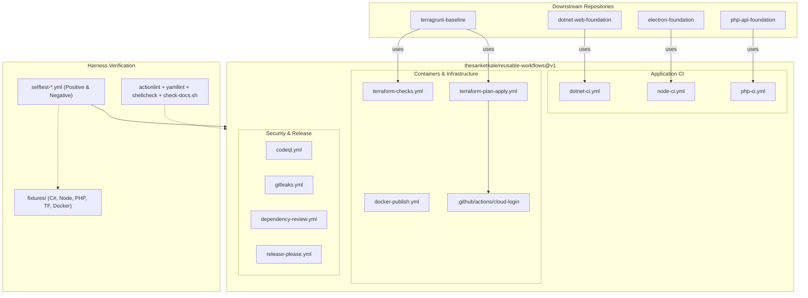

# reusable-workflows

[](https://github.com/thesanketkale/reusable-workflows/actions/workflows/ci.yml)
[](https://github.com/thesanketkale/reusable-workflows/releases)
[](LICENSE)

> Versioned, least-privilege reusable GitHub Actions workflows for .NET, Node, PHP, Docker, Terraform and release automation, with self-tests and caller examples.

---

## 1. Why It Exists

Modern engineering teams building multi-stack repositories often duplicate boilerplate CI/CD workflow YAML. This duplication leads to configuration drift, unpinned third-party actions vulnerable to supply-chain attacks, ambient overprivileged tokens, and fragile credential-sharing practices.

While organizations often build custom composite actions or adopt monolithic monorepo orchestration tools (such as Nx or Turborepo), standalone multi-repository ecosystems need modular, hardened continuous integration primitives. `reusable-workflows` solves this by delivering:
- **Strict Least-Privilege Scoping:** Minimal top-level permissions (`permissions: {}`), granting elevated scopes (`id-token: write`, `packages: write`) exclusively to individual jobs that require them.
- **Zero Hallucinated or Floating Action Dependencies:** Every external third-party action is pinned to an immutable 40-character commit SHA with automated Dependabot tracking.
- **Keyless Cloud Integration:** Unified OpenID Connect (OIDC) authentication across AWS and Azure, entirely eliminating static cloud access keys.
- **Continuous Documentation Verification:** An integrated contract linter (`scripts/check-docs.sh`) that guarantees workflow inputs never diverge from their reference documentation.

---

## 2. Features

- **Application CI Pipelines:** Drop-in reusable workflows for `.NET` (format verification, test execution, Cobertura coverage summaries), `Node.js` (npm/pnpm/yarn, lint, test, build), and `PHP` (PHP 8.2/8.3/8.4 matrix, strict Composer validation, PHPStan, PHPUnit, and security audits).
- **Container Publishing:** Hardened multi-platform Docker builds via Buildx, GHCR authentication, and cryptographic provenance + SBOM attestations.
- **Infrastructure Automation:** Credential-free Terraform/OpenTofu static checks (formatting, validation, TFLint, Checkov) and OIDC-driven plan & apply workflows with sticky pull request comments and GitHub Environment gates.
- **Unified Cloud Login:** A singular composite action (`.github/actions/cloud-login`) abstracting AWS STS and Azure Entra ID federated authentication.
- **DevSecOps & Supply Chain Defense:** Pre-configured CodeQL static analysis, Gitleaks full-history scanning, and GitHub Dependency Review gates.
- **Self-Testing Harness:** End-to-end self-tests executing against realistic fixtures in `fixtures/`, including negative failure-propagation verification.

---

## 3. Quickstart

Integrate a reusable workflow into your repository in under 2 minutes:

```bash
# 1. Clone your project repository
git clone https://github.com/your-org/your-repo.git && cd your-repo

# 2. Create the GitHub Actions workflow directory
mkdir -p .github/workflows

# 3. Add a caller workflow calling reusable-workflows
cat << 'EOF' > .github/workflows/ci.yml
name: 'CI'
on:
  push:
    branches: ['main']
  pull_request:
    branches: ['main']
permissions: {}
jobs:
  test:
    uses: thesanketkale/reusable-workflows/.github/workflows/node-ci.yml@v1
    permissions:
      contents: read
    with:
      node-version: '20.x'
      package-manager: 'npm'
EOF

# 4. Commit and push your workflow
git add .github/workflows/ci.yml
git commit -m "ci: call reusable node workflow"
git push origin main
```

---

## 4. Architecture Overview



---

## 5. Workflow Catalog

| Workflow | Purpose | Required Permissions | Required Secrets | Reference Doc |
|---|---|---|---|---|
| [`dotnet-ci.yml`](.github/workflows/dotnet-ci.yml) | .NET restore, build, format verification, tests, and Cobertura coverage | `contents: read` | None | [docs/dotnet-ci.md](docs/workflows/dotnet-ci.md) |
| [`node-ci.yml`](.github/workflows/node-ci.yml) | Node.js frozen lockfile install, lint, test, and build across npm/pnpm/yarn | `contents: read` | None | [docs/node-ci.md](docs/workflows/node-ci.md) |
| [`php-ci.yml`](.github/workflows/php-ci.yml) | PHP 8.2/8.3/8.4 matrix, strict Composer validation, PHPStan, PHPUnit, and audit | `contents: read` | None | [docs/php-ci.md](docs/workflows/php-ci.md) |
| [`docker-publish.yml`](.github/workflows/docker-publish.yml) | Docker Buildx, GHCR push, multi-arch build, SBOM and provenance attestations | `contents: read`, `packages: write`, `id-token: write`, `attestations: write` | None (uses `github.token`) | [docs/docker-publish.md](docs/workflows/docker-publish.md) |
| [`terraform-checks.yml`](.github/workflows/terraform-checks.yml) | Credential-free Terraform/OpenTofu fmt, validate, TFLint, and Checkov scan | `contents: read` | None | [docs/terraform-checks.md](docs/workflows/terraform-checks.md) |
| [`terraform-plan-apply.yml`](.github/workflows/terraform-plan-apply.yml) | OIDC cloud authentication, sticky PR plan comment, protected Environment apply | `contents: read`, `id-token: write`, `pull-requests: write`, `issues: write` | None (OIDC keyless) | [docs/terraform-plan-apply.md](docs/workflows/terraform-plan-apply.md) |
| [`release-please.yml`](.github/workflows/release-please.yml) | Automated semantic release PRs, changelog updates, and git tagging | `contents: write`, `pull-requests: write` | Optional `token` | [docs/release-please.md](docs/workflows/release-please.md) |
| [`codeql.yml`](.github/workflows/codeql.yml) | Static code security analysis with GitHub CodeQL scanner | `contents: read`, `security-events: write` | None | [docs/codeql.md](docs/workflows/codeql.md) |
| [`dependency-review.yml`](.github/workflows/dependency-review.yml) | Pull request dependency security and license compliance evaluation | `contents: read`, `pull-requests: write` | None | [docs/dependency-review.md](docs/workflows/dependency-review.md) |
| [`gitleaks.yml`](.github/workflows/gitleaks.yml) | Complete git history secret scanning with Gitleaks | `contents: read` | None | [docs/gitleaks.md](docs/workflows/gitleaks.md) |

---

## 6. Usage Examples

### 6.1 Calling by Major Tag vs. Immutable Commit SHA

**Standard Consumption (Floating Major Tag):**
```yaml
uses: thesanketkale/reusable-workflows/.github/workflows/node-ci.yml@v1
```
*Benefits:* Seamlessly receives backwards-compatible patches and minor improvements without manual updates.

**Hardened Zero-Trust Consumption (Pinned Commit SHA):**
```yaml
uses: thesanketkale/reusable-workflows/.github/workflows/node-ci.yml@3429423b4971c08003f5cefe5b5003610e25c0e1 # v1.0.0
```
*Benefits:* Complete immutability against supply-chain tampering.

Ready-to-use caller templates are available in the [`examples/`](examples/) folder:
- [.NET Caller Example](examples/dotnet-caller.yml)
- [Node.js Caller Example](examples/node-caller.yml)
- [PHP Caller Example](examples/php-caller.yml)
- [Docker Publish Caller Example](examples/docker-caller.yml)
- [Terraform Caller Example](examples/terraform-caller.yml)

---

## 7. Troubleshooting & FAQ

### Why did `actionlint` or `yamllint` fail in my pull request?
Ensure your workflow specifies `shell: bash` or `shell: pwsh` when using non-default scripting syntax. On Windows runners, quote all paths to prevent backslash interpretation errors.

### Why is `id-token: write` required for `docker-publish.yml`?
GitHub generates cryptographic build provenance and Software Bill of Materials (SBOM) attestations using Sigstore. The runner exchanges an OIDC token to sign these attestations publicly.

### How do I run verification checks locally?
Run the unified verification script from your terminal:
```bash
# Fast check (< 30 seconds):
pwsh -NoProfile -ExecutionPolicy Bypass -File scripts/verify.ps1 fast

# Full check (actionlint, yamllint, shellcheck, doc sync):
pwsh -NoProfile -ExecutionPolicy Bypass -File scripts/verify.ps1 full
```

---

## 8. Security & Known Limitations

- **No Untrusted Checkouts (`pull_request_target`):** Workflows intentionally reject `pull_request_target` triggers to protect secrets and OIDC tokens from malicious forks.
- **OIDC Subject Scoping:** Always constrain AWS IAM Role Trust Relationships and Azure Federated Credentials to specific repositories and branches (e.g. `repo:thesanketkale/reusable-workflows:ref:refs/heads/main`). See [docs/security.md](docs/security.md).
- **Out of Scope:** Workflows do not publish packages to the public GitHub Actions Marketplace, and host-specific deployments (FTP, App Service, ECS) are intentionally encapsulated within downstream foundation repositories.

---

## 9. Verification Status

| Capability | Status | Verification Method |
|---|---|---|
| .NET CI Pipeline | Verified | Automated self-test via `selftest-dotnet.yml` against `fixtures/dotnet/` |
| Node.js CI Pipeline | Verified | Automated self-test via `selftest-node.yml` against `fixtures/node/` |
| PHP CI Pipeline | Verified | Automated self-test via `selftest-php.yml` against `fixtures/php/` |
| Docker Container Publish | Verified | Automated self-test via `selftest-docker.yml` against `fixtures/docker/` |
| Terraform Credential-Free Checks | Verified | Automated self-test via `selftest-terraform.yml` against `fixtures/terraform/` |
| Failure Propagation | Verified | Negative self-test via `selftest-failure-propagation.yml` against `fixtures/dotnet-failing/` |
| Workflow Syntax & Linting | Verified | `actionlint`, `yamllint`, and `shellcheck` executed in `ci.yml` |
| Documentation Contract Match | Verified | Verified in CI via `scripts/check-docs.sh` |
| AWS & Azure Live OIDC Login | **Owner-Verified** | Documented with reproduction runbooks in [`docs/verification-log.md`](docs/verification-log.md) |
| Terraform Production Apply Gate | **Owner-Verified** | Gated by GitHub Environment approvals; documented in `docs/verification-log.md` |

---

## 10. Roadmap

- [ ] Add Go CI reusable workflow (`go-ci.yml`) with test, lint, and vulnerability scanning.
- [ ] Add Python package build and publishing reusable workflow.
- [ ] Native OpenTofu registry publishing support.

---

## 11. Contributing & Governance

Contributions are welcome! Please read [CONTRIBUTING.md](CONTRIBUTING.md) and [CODE_OF_CONDUCT.md](CODE_OF_CONDUCT.md) before submitting a pull request. Report security vulnerabilities according to [SECURITY.md](SECURITY.md).

### Related Projects

This library forms the continuous integration foundation for the `@thesanketkale` open-source suite:
- [`php-api-foundation`](https://github.com/thesanketkale/php-api-foundation) – Dependency-light PHP 8.3 REST API skeleton with FTP shared-hosting and OIDC cloud deploys.
- [`electron-foundation`](https://github.com/thesanketkale/electron-foundation) – Security-first Electron + TypeScript desktop foundation with typed IPC and signed release pipelines.
- [`dotnet-web-foundation`](https://github.com/thesanketkale/dotnet-web-foundation) – Modular ASP.NET Core web application foundation with Identity, user profiles, admin CMS, and EF Core.
- [`terragrunt-baseline`](https://github.com/thesanketkale/terragrunt-baseline) – Multi-environment Terragrunt baseline for AWS and Azure with GitHub OIDC federation.
- [`unity-openxr-foundation`](https://github.com/thesanketkale/unity-openxr-foundation) – OpenXR project base for standalone headsets.
- [`unity-build-pipeline`](https://github.com/thesanketkale/unity-build-pipeline) – Self-hosted Unity build, test, and release pipeline on GitHub Actions.
- [`unity-ui-context`](https://github.com/thesanketkale/unity-ui-context) – Unity editor package that makes uGUI readable by AI coding agents.
- [`job-desk`](https://github.com/thesanketkale/job-desk) – Local-first desktop job search and application assistant.

---

## License

MIT License. Copyright (c) 2026 Sanket Kale. See [LICENSE](LICENSE) for details.
