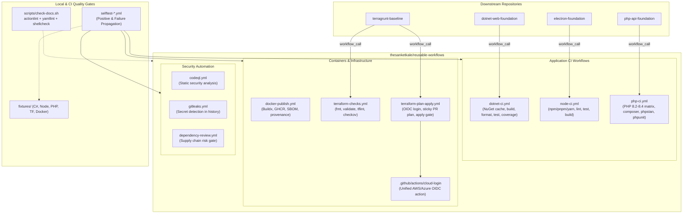

# System Architecture: reusable-workflows

`reusable-workflows` provides a battle-tested, least-privilege catalog of reusable GitHub Actions workflows and composite actions. It serves as the continuous integration, continuous delivery, and DevSecOps backbone for the `@thesanketkale` open-source repository suite.

---

## 1. Architectural Overview & Calling Model

Downstream repositories reference workflows in this repository using GitHub's `workflow_call` mechanism:

```
uses: thesanketkale/reusable-workflows/.github/workflows/<name>.yml@v1
```

Alternatively, security-conscious deployments can pin to an immutable commit SHA:

```
uses: thesanketkale/reusable-workflows/.github/workflows/<name>.yml@0bc1338... # v1.0.0
```



---

## 2. Security Boundaries and Trust Model

### 2.1 Least-Privilege Scope Isolation
Workflows do not inherit ambient permissions from the caller repository. Every reusable workflow strictly enforces least-privilege scoping:
- **Default Permissions:** Every workflow explicitly defines required job-level permissions, defaulting to read-only (`contents: read`).
- **OIDC Scoping:** `id-token: write` is restricted exclusively to jobs executing AWS/Azure cloud authentication or generating cryptographic build provenance/SBOM attestations.
- **Write Operations:** `pull-requests: write` is granted only where sticky comment posting or dependency review annotations are needed.

### 2.2 Prevention of Script Injection
Untrusted context variables (such as issue titles, commit messages, PR head refs, and pull request comments) are never interpolated directly inside `run:` shell strings. Whenever dynamic values are required, they are passed as environment variables:
```yaml
env:
  PR_COMMENT_BODY: ${{ inputs.comment-body }}
run: |
  printf '%s\n' "$PR_COMMENT_BODY" > comment.txt
```

### 2.3 Strict Rejection of `pull_request_target`
`pull_request_target` runs in the context of the base repository and has access to secrets. This repository and all downstream workflows avoid `pull_request_target` for untrusted checkouts to prevent malicious pull requests from reading OIDC credentials or modifying pipeline logic.

---

## 3. Workflow Design Principles

1. **Deterministic Inputs & Sensible Defaults:**
   All parameters are typed (`string`, `boolean`, `number`) with sensible defaults so callers can get started with minimal configuration while retaining fine-grained override capabilities.
2. **Built-in Caching:**
   Workflows leverage native dependency caching (NuGet, npm/pnpm/yarn, Composer, Docker layer caching) with hash-based cache keys to accelerate turnaround times.
3. **Structured Job Summaries:**
   Test results, code coverage, formatting diffs, and container build metadata are rendered directly to `$GITHUB_STEP_SUMMARY` using standard Markdown and GitHub alerts.
4. **Self-Contained Verification:**
   Every reusable workflow is tested against realistic, synthetically authored fixtures in `fixtures/` to verify that regressions are blocked before reaching callers.
